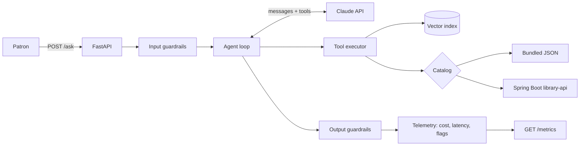

# 📚🤖 Library AI Assistant

A production-style AI assistant for a library, built on **Claude**. Patrons ask questions in plain English; the assistant searches the catalog with **retrieval-augmented generation**, calls **tools** to look up and borrow books, and always answers with a **validated structured output**. Every request is checked by **guardrails**, traced for **cost and latency**, and the whole system is measured by an **eval suite** that runs in CI.


It can run on its own bundled catalog, or act on real data through my Spring Boot **[library-api](https://github.com/AnjanRimal/library-api)**.

## ✨ What it does

```text
$ python -m library_assistant "I'm learning infrastructure as code for AWS. What should I read?"
```

1. Checks the question against input guardrails.
2. Claude calls `search_catalog`, which embeds the query and finds the closest books.
3. Claude reads the results and may call `get_book` for live availability.
4. Claude finishes with `submit_answer`: a JSON object validated against a Pydantic schema.
5. Output guardrails drop any book the model cites without having retrieved it.
6. The request is logged with its tokens, cost, latency and tool calls.

## 🏗️ Architecture



## 🔑 Features

| Area | How it's done |
|---|---|
| **RAG** | Catalog entries are embedded into an in-memory vector index; `search_catalog` returns the top matches by cosine similarity. The embedder is pluggable (offline hashing or `sentence-transformers`). |
| **Tool calling** | `search_catalog`, `get_book`, `borrow_book`. Tool failures go back to Claude as `is_error` results so it can recover instead of crashing. |
| **Structured output** | The agent must end with `submit_answer`, whose schema comes from the `AssistantAnswer` Pydantic model. Invalid answers are sent back with the validation errors for a fix. |
| **Agent loop control** | Step limit; forces `submit_answer` on the last step or after a plain-text reply; rejects an answer submitted in the same turn as other tool calls, since it was written before seeing their results. |
| **Guardrails** | Blocks empty or oversized input, flags likely prompt injection, removes ungrounded citations, and flags any claimed borrow with no successful `borrow_book` call. |
| **Safe actions** | `borrow_book` takes the member id from the authenticated request, never from the conversation, so a prompt can't borrow on someone else's account. |
| **Observability** | One JSON log line per request, plus `GET /metrics` with tokens, cost, p50/p95 latency, tool errors and guardrail counts. |
| **Evals** | Offline retrieval eval (recall@3, MRR) gates CI; live agent eval checks intents, tool use, citations and safety. |

## 🚀 Quick start

```bash
git clone https://github.com/AnjanRimal/library-ai-assistant.git
cd library-ai-assistant
python -m venv .venv && source .venv/bin/activate
pip install -e ".[dev]"

export ANTHROPIC_API_KEY=your-key        # see .env.example for all settings
```

**Command line**
```bash
python -m library_assistant "Recommend a book on building LLM applications"
python -m library_assistant "Please borrow Clean Code" --member-id 7
python -m library_assistant "Any Python books?" --json    # full structured response
```

**REST API**
```bash
uvicorn library_assistant.api:app --reload
```
```bash
curl -X POST localhost:8000/ask -H "Content-Type: application/json" \
  -d '{"question": "Is Kubernetes Up and Running available?"}'

curl localhost:8000/metrics
```
Interactive docs are at **http://localhost:8000/docs**.

**Docker**
```bash
docker build -t library-ai-assistant .
docker run -p 8000:8000 -e ANTHROPIC_API_KEY=your-key library-ai-assistant
```

### Use the Spring Boot library-api as the catalog
Start [library-api](https://github.com/AnjanRimal/library-api) on port 8080, then:
```bash
export LIA_CATALOG=api
export LIA_LIBRARY_API_URL=http://localhost:8080
```
Borrowing now calls `POST /members/{id}/borrow/{bookId}` on the Java service.

## 📏 Evals

```bash
python -m evals.run retrieval   # offline, runs in CI on every push
python -m evals.run agent       # live, calls Claude (needs ANTHROPIC_API_KEY)
```

Both suites print a results table, save JSON to `evals/results/`, and exit non-zero below their thresholds, so a regression fails the build.

**Retrieval** (26 cases, default hashing embedder):

| Query type | Cases | Recall@3 | MRR |
|---|---|---|---|
| Keyword (shares words with the catalog) | 20 | 1.000 | 1.000 |
| Paraphrase (same meaning, different words) | 6 | 0.667 | 0.506 |
| **Overall** (CI gate: recall@3 ≥ 0.85, MRR ≥ 0.75) | 26 | **0.923** | **0.886** |

The paraphrase set is there on purpose: it shows the limit of a lexical embedder. Switching to `LIA_EMBEDDER=sentence-transformers` (`pip install -e ".[semantic]"`) is the fix, and the same eval measures whether it helps.

**Agent** (9 live cases in [`evals/cases.json`](evals/cases.json)) checks that the assistant:
- searches before recommending and cites the right books
- borrows only when asked, and only for a signed-in member
- says so when a book is on loan and suggests an available alternative
- declines out-of-scope questions and doesn't invent books that aren't in the catalog
- ignores a prompt-injection attempt to borrow every book

The live suite runs on demand in GitHub Actions (**Actions → CI → Run workflow**) after you add `ANTHROPIC_API_KEY` as a repository secret.

## 🧪 Tests

```bash
pytest -q
```

50 tests, no API key or network needed. Agent logic is tested with a scripted fake client, and one integration test drives the real Anthropic SDK against a mocked HTTP transport to prove the requests and responses round-trip correctly. The library-api adapter is tested the same way.

## 🗂️ Project structure

```
library_assistant/
├── agent.py        Agent loop: tool calls, forced structured answer, step limit
├── tools.py        Tool schemas and the executor that runs them
├── retrieval.py    In-memory vector index
├── embeddings.py   Hashing (offline) and sentence-transformers embedders
├── catalog.py      Local JSON catalog and the Spring Boot library-api adapter
├── guardrails.py   Input and output checks
├── telemetry.py    Cost, latency and flag tracking
├── models.py       Pydantic models, including the structured answer schema
├── api.py          FastAPI app: /ask, /metrics, /health
└── __main__.py     Command-line interface
evals/              Eval cases and runner
tests/              Unit and integration tests
```

## 🛣️ Roadmap
- [ ] Persistent vector store (pgvector) in place of the in-memory index
- [ ] Prompt caching for the system prompt and tool definitions to cut cost
- [ ] Streaming responses
- [ ] LLM-as-judge grading for answer quality, alongside the rule-based checks
- [ ] OpenTelemetry traces

## 👤 Author
**Anjan Rimal** · [Portfolio](https://anjanrimal.com/) · [LinkedIn](https://www.linkedin.com/in/anjanrimal) · [GitHub](https://github.com/AnjanRimal)
